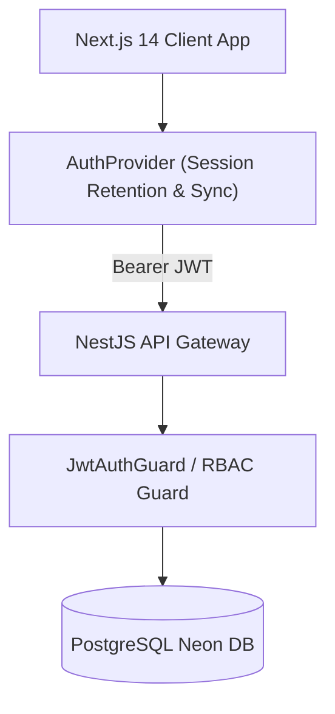

# 📋 Comprehensive Requirements Specification Matrix

This document provides the definitive specification of **Functional Requirements (FR)** and **Non-Functional Requirements (NFR)** for the **Portfolio Showcase Platform** ([MysticsWinner/PortfolioShowcase](https://github.com/MysticsWinner/PortfolioShowcase)).

---

## 🎯 Architectural Overview
The platform couples a headless presentation and telemetry layer powered by **Next.js 14 App Router** with a hardened control gateway powered by **NestJS 11** and **PostgreSQL (Prisma ORM)**.

---

## ⚡ 20 Functional Requirements (FR)

### FR-01: Multi-Factor & OTP Email Account Verification
- **Description:** Upon registration, user accounts are initialized in an inactive state (`isActive: false`). The system generates a cryptographically random One-Time Password (OTP) dispatched via SMTP or console fallback.
- **Actor:** Unverified User / System.
- **Trigger:** Registration submission via `POST /auth/register` or resend request via `POST /auth/resend-otp`.
- **Pre-conditions:** User provided unique email and password meeting security standards.
- **Post-conditions:** Account transitioned to `isActive: true`, OTP wiped from database, authenticated JWT token returned.
- **Acceptance Criteria:** Expired or mismatched OTP attempts are rejected with HTTP 400. Verification automatically provisions authenticated session.

### FR-02: Self-Healing Profile Re-hydration & Session Heartbeat (`GET /auth/me`)
- **Description:** On client mount or application refresh, the client verifies token validity by querying `GET /auth/me`.
- **Actor:** Authenticated User / Client Runtime.
- **Trigger:** Next.js application mount, browser tab focus, or manual profile refresh.
- **Pre-conditions:** Client possesses an unexpired Bearer token in local storage or cookie.
- **Post-conditions:** Returns sanitized user profile containing ID, name, email, role, and active status without sensitive password or OTP hashes.
- **Acceptance Criteria:** If token is invalid or user has been revoked, client intercepts HTTP 401, clears storage, and smoothly routes to login.

### FR-03: Stateful Remember-Me Session Retention & Cross-Tab State Sync
- **Description:** Users can toggle "Remember me for 30 days" during login. When enabled, credentials preference and session persistence survive tab closures.
- **Actor:** User.
- **Trigger:** Login form submission with `rememberMe` checkbox state.
- **Pre-conditions:** Valid credentials submitted.
- **Post-conditions:** Token and user profile stored with persistence metadata; storage events broadcast state across all open browser windows simultaneously.
- **Acceptance Criteria:** Logging out or in on Tab A immediately updates Navbar identity display on Tab B without manual refresh.

### FR-04: Graceful Post-Authentication Return URL Redirection
- **Description:** When an unauthenticated visitor attempts to access protected routes (e.g., dynamic resume, dashboard, CMS), the destination path is encoded into a `?redirect=` query parameter.
- **Actor:** Unauthenticated Visitor.
- **Trigger:** Navigation to protected page or clicking resume generation button while logged out.
- **Pre-conditions:** User session absent.
- **Post-conditions:** User is redirected to `/auth/login?redirect=...`. Upon successful authentication, user is returned directly to requested URL.
- **Acceptance Criteria:** Redirect parameter survives registration and OTP verification flows.

### FR-05: Dynamic User Identity, Status & Avatar Presentation
- **Description:** Navbar and sidebar dynamically render the active user's initials, name, verified status badge, and role pill (`ADMIN` vs. `MEMBER`).
- **Actor:** Authenticated User.
- **Trigger:** Session load or profile dropdown trigger.
- **Pre-conditions:** Authenticated session active in `AuthProvider`.
- **Post-conditions:** Renders interactive profile menu with quick links (Dashboard, Portfolios, Resume, Admin Panel) and Sign Out control.
- **Acceptance Criteria:** Dropdown closes on route transitions and outside clicks; avatar gracefully falls back to initials if no custom image is set.

### FR-06: Role-Based Access Control (RBAC) Hierarchical Route & Component Isolation
- **Description:** Routes and API endpoints enforce strict role hierarchies. Administrative operations (`/dashboard/admin`, `/dashboard/cms`) require `role: ADMIN`.
- **Actor:** User / Admin.
- **Trigger:** Navigation to admin views or API dispatch to admin endpoints.
- **Pre-conditions:** Valid JWT presented containing role claim.
- **Post-conditions:** Permitted if role satisfies requirement; HTTP 403 Forbidden dispatched otherwise.
- **Acceptance Criteria:** Non-admin users are prevented from seeing administrative navigation links and cannot execute user-status toggle mutations.

### FR-07: Interactive Command Palette (`Cmd + K`) Deep Navigation & Quick Actions
- **Description:** A global modal keyboard shortcut (`Cmd + K` or `Ctrl + K`) enables instant searching and keyboard navigation across all portal pages, documents, and external links.
- **Actor:** Visitor / User.
- **Trigger:** Pressing `Cmd/Ctrl + K` or clicking search trigger.
- **Pre-conditions:** Page initialized with `CommandPalette` component mounted.
- **Post-conditions:** Displays searchable index of Home, Blog, Contact, Dynamic Resume, Admin, and GitHub repository source code.
- **Acceptance Criteria:** Navigating via arrow keys and pressing Enter immediately executes target action; modal dismisses on Esc.

### FR-08: Native Dynamic Resume Compilation to PDF (`@react-pdf/renderer`)
- **Description:** Authenticated users can generate an on-the-fly, vector-precise PDF resume populated with user metadata and professional portfolio history.
- **Actor:** Authenticated User.
- **Trigger:** Clicking "Resume" in navigation or dashboard.
- **Pre-conditions:** User authenticated with name and email available.
- **Post-conditions:** Server-side route `/api/resume` compiles PDF stream rendered with `@react-pdf/renderer` directly to the browser.
- **Acceptance Criteria:** Dispatched with proper `Content-Type: application/pdf` and downloadable inline or via virtual anchor.

### FR-09: Isolated Portfolio Binary Blob Upload & Storage in PostgreSQL `Bytea`
- **Description:** Users can attach physical PDF or DOCX documentation directly to their portfolio records.
- **Actor:** User.
- **Trigger:** File selection and submission in portfolio creation/edit form.
- **Pre-conditions:** Authenticated user with ownership of target portfolio record.
- **Post-conditions:** Binary buffer transmitted via multipart/form-data and stored directly into PostgreSQL `fileData` (`Bytea`) column with MIME type validation.
- **Acceptance Criteria:** Storage survives ephemeral container restarts without data loss; maximum payload limited to 10MB.

### FR-10: Authenticated Streaming Binary Download of User Portfolios
- **Description:** Protected route `/portfolios/:id/download` retrieves stored binary file buffer and streams it to authorized users without exposing public S3 bucket URLs.
- **Actor:** Authenticated User.
- **Trigger:** Clicking download attachment on portfolio card.
- **Pre-conditions:** Requesting user owns portfolio or possesses `ADMIN` role.
- **Post-conditions:** Binary stream delivered with proper `Content-Disposition` attachment headers triggering browser download.
- **Acceptance Criteria:** Unauthorized users receive HTTP 401/403; temporary object URLs are revoked from client DOM immediately after execution.

### FR-11: Real-Time WebSocket Bi-Directional Live Chat Gateway (`Socket.io`)
- **Description:** Interactive live chat widget enables instant messaging between visitors and administrators over a secured WebSocket tunnel.
- **Actor:** Visitor / Admin.
- **Trigger:** Opening chat widget and submitting text message.
- **Pre-conditions:** WebSocket gateway active on NestJS backend.
- **Post-conditions:** Message sanitized, persisted in chat store, and broadcasted to connected administrative clients.
- **Acceptance Criteria:** Automatic reconnection with exponential backoff on connection drops; input sanitized against XSS vectors.

### FR-12: Headless Native Visitor Analytics & Telemetry Tracking
- **Description:** In-house telemetry provider captures page views, referrers, and engagement metrics natively into PostgreSQL without third-party tracking scripts.
- **Actor:** System / Visitor.
- **Trigger:** Next.js route change intercepted by `AnalyticsProvider`.
- **Pre-conditions:** Client route navigation executed.
- **Post-conditions:** Fire-and-forget payload sent to `POST /analytics/track` storing event timestamp, path, and sanitized user-agent.
- **Acceptance Criteria:** Zero impact on page rendering speed; fails silently if telemetry backend is unreachable.

### FR-13: Full-Spectrum CMS Content Operations for Public Projects & Works
- **Description:** Administrative portal `/dashboard/cms` provides create, read, update, and delete (CRUD) operations for featured showcase projects and external works.
- **Actor:** Admin.
- **Trigger:** CMS form submission or deletion action.
- **Pre-conditions:** Valid `ADMIN` JWT session.
- **Post-conditions:** Database record updated and cache invalidation signal dispatched to ensure immediate reflection on public pages.
- **Acceptance Criteria:** Form validations prevent empty titles, malformed URLs, or corrupted project descriptions.

### FR-14: Admin User Management Panel
- **Description:** Central dashboard `/dashboard/admin` lists all registered accounts with controls to toggle active status and promote/demote between `VIEWER` and `ADMIN` roles.
- **Actor:** Admin.
- **Trigger:** Clicking status or role toggle button in user table.
- **Pre-conditions:** Requester holds validated `ADMIN` role.
- **Post-conditions:** Database user updated; affected user's subsequent API requests immediately reflect updated privileges.
- **Acceptance Criteria:** Admins cannot accidentally deactivate their own active administrative account.

### FR-15: Automated Contact Form Ingestion with SMTP Email Notification Dispatch
- **Description:** Public `/contact` page allows visitors to submit inquiries. System records the message and sends an email notification to the site administrator.
- **Actor:** Visitor.
- **Trigger:** Contact form submission.
- **Pre-conditions:** Valid sender name, email, and message body.
- **Post-conditions:** Record created in `ContactMessage` table; SMTP email dispatched via `MailService`.
- **Acceptance Criteria:** Rate limiting prevents spam floods; fails gracefully to database persistence if SMTP host is temporarily down.

### FR-16: Newsletter Subscription Engine with De-duplication
- **Description:** Newsletter widget on homepage and footer allows visitors to subscribe for project updates.
- **Actor:** Visitor.
- **Trigger:** Submitting email in newsletter form.
- **Pre-conditions:** Valid RFC 5322 email string.
- **Post-conditions:** Stored in `Subscriber` model; duplicates are gracefully acknowledged without error.
- **Acceptance Criteria:** Email confirmation sent upon initial subscription.

### FR-17: Instant Client-Side Global Logout with Cache Obliteration
- **Description:** Invoking logout immediately destroys all client credentials, tokens, cached user objects, and axios default authorization headers.
- **Actor:** Authenticated User.
- **Trigger:** Clicking "Sign Out" in Navbar, profile menu, or sidebar.
- **Pre-conditions:** Active authenticated session.
- **Post-conditions:** `localStorage.removeItem('token')`, `localStorage.removeItem('user')`, context state reset to null, redirect to `/auth/login`.
- **Acceptance Criteria:** Navigation back button cannot access cached authenticated views after logout.

### FR-18: Unverified Account Interception & Resend OTP Recovery Flow
- **Description:** If an unverified user attempts to log in, the system intercepts the attempt with an `ACCOUNT_NOT_VERIFIED` signal and displays an immediate one-click activation button.
- **Actor:** Unverified User.
- **Trigger:** Login attempt with valid password on inactive account.
- **Pre-conditions:** Account exists with `isActive: false`.
- **Post-conditions:** Login form renders warning banner with "Activate Account with OTP" button routing to `/auth/verify?email=...`.
- **Acceptance Criteria:** User can request a fresh OTP with a 60-second cooldown timer.

### FR-19: Dynamic Interactive WebGL Canvas with Device-Adaptive Performance
- **Description:** Homepage hero section features interactive 3D WebGL particle graphics (`HeroCanvas`) that dynamically responds to cursor movement.
- **Actor:** Visitor.
- **Trigger:** Page load and cursor hover over hero section.
- **Pre-conditions:** Browser supports WebGL rendering context.
- **Post-conditions:** Rendered at 60 FPS utilizing Three.js and React Three Fiber via `next/dynamic` lazy loading.
- **Acceptance Criteria:** Gracefully falls back to animated CSS gradient on devices without WebGL capability.

### FR-20: Dynamic Blog & Dev Log Markdown Content Rendering
- **Description:** Developer log and technical blog at `/blog` compiles Markdown/MDX content with frontmatter metadata extraction.
- **Actor:** Visitor / Reader.
- **Trigger:** Visiting `/blog` or individual article pages.
- **Pre-conditions:** Markdown content files present in content repository.
- **Post-conditions:** Formatted HTML output with syntax-highlighted code blocks, reading time estimates, and tag taxonomy.
- **Acceptance Criteria:** Supports responsive images, tables, and blockquotes with zero layout shift.

---

## 🛡️ 20 Non-Functional Requirements (NFR)

### Security (SEC)
- **NFR-01: End-to-End Strict Password Hashing via Bcrypt:** All user passwords must be hashed utilizing Bcrypt with a salt work factor of at least 10 rounds prior to database insertion. Raw passwords must never be logged or stored.
- **NFR-02: Stateless Cryptographic JWT Signing:** Access tokens must be signed using HMAC SHA-256 with an ephemeral 15-minute expiration window containing only minimal non-PII claims (`sub: userId, role`).
- **NFR-03: Strict HTTP Transport Layer Hardening:** The API gateway must enforce HTTP Security Headers via `helmet`, including `X-Content-Type-Options: nosniff`, `X-Frame-Options: DENY`, `Strict-Transport-Security`, and Content Security Policy (CSP).
- **NFR-04: Denial-of-Service Defense & Rate Limiting:** All incoming HTTP requests must pass through `@nestjs/throttler` with a strict threshold (100 requests per minute per IP address on public endpoints; 10 requests per minute on auth routes).
- **NFR-05: Anti-CSRF and XSS Immune Token Transmission:** Client tokens must be held in controlled JavaScript memory and dynamically injected via Axios request interceptors, preventing automated cross-site forgery.

### Performance & Latency (PERF)
- **NFR-06: Sub-10ms Cached Latency for Public Endpoints:** Frequently queried read endpoints (e.g., `GET /projects`, `GET /portfolios/public`) must leverage in-memory / Redis cache caching to eliminate redundant database locks.
- **NFR-07: Sub-1.5s First Contentful Paint (FCP):** Frontend bundle delivery must achieve an FCP under 1.5 seconds on simulated 4G network conditions through server components and dynamic code splitting.
- **NFR-08: Zero Cumulative Layout Shift (CLS < 0.05):** All responsive views must maintain a Cumulative Layout Shift score below 0.05 across standard mobile, tablet, and desktop viewports.
- **NFR-09: Lazy WebGL Bundle Extraction:** Heavy 3D graphics libraries (Three.js, Drei) must be loaded dynamically (`next/dynamic` with `ssr: false`) to ensure initial bundle footprint remains under 120KB gzipped.

### Reliability & Availability (REL)
- **NFR-10: 99.95% API Service Availability:** The backend control gateway must maintain 99.95% uptime with built-in health probe endpoints (`/health`, `/ready`) for automated container recovery.
- **NFR-11: Database Connection Elasticity & Resilience:** PostgreSQL connections via Prisma Client must maintain connection pooling capable of handling traffic spikes without exhausting pool limits on serverless infrastructure.
- **NFR-12: Fault-Tolerant Mail Service Graceful Degradation:** SMTP transport failures must not abort user-facing requests; OTPs and contact notifications must fall back to structured server logs during provider outages.
- **NFR-13: Disaster Recovery & Automated Snapshot Backup Policies:** Database state must be backed up daily with point-in-time recovery enabling restoration within 30 minutes in case of catastrophic storage loss.

### Scalability (SCAL)
- **NFR-14: Monorepo Hermetic Isolation & Zero Binary Leakage:** Monorepo architecture managed by PNPM Workspaces must maintain strict package boundaries with no shared undeclared dependencies across `apps/frontend` and `apps/backend`.
- **NFR-15: Postgres Bytea Binary Size Enforcement:** Portfolio binary attachments stored in PostgreSQL must be validated and rejected if payload exceeds 10MB to protect memory allocation.
- **NFR-16: Horizontal Edge Scalability:** Frontend presentation tier must deploy to edge CDN networks (e.g. Vercel) capable of serving global requests with under 50ms time-to-first-byte (TTFB).

### Usability & Accessibility (UX/A11Y)
- **NFR-17: WCAG 2.1 Level AA Accessibility Compliance:** All interactive elements must maintain a minimum 4.5:1 color contrast ratio, full keyboard focus rings, and proper ARIA role attributes.
- **NFR-18: Responsive Cross-Device Viewport Adaptability:** Layouts must adapt fluidly across viewport widths from 320px (mobile) to 2560px (ultra-wide) without horizontal scrollbar overflow.
- **NFR-19: Cross-Browser Compatibility Matrix:** The platform must execute identically across modern versions of Chromium (Chrome, Edge, Brave), Gecko (Firefox), and WebKit (Safari, iOS Safari).

### Maintainability & Open Source (MAINT)
- **NFR-20: Open-Source Repository Attribution & CI/CD Gating:** All repository links on the live platform must point accurately to [MysticsWinner/PortfolioShowcase](https://github.com/MysticsWinner/PortfolioShowcase). Every pull request must pass automated GitHub Actions linting and unit test matrices prior to merging.

---

[← Return to Master Plan](../Readme.md)
